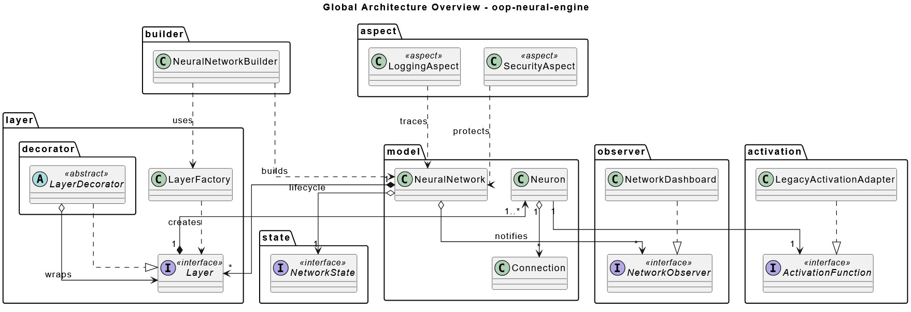
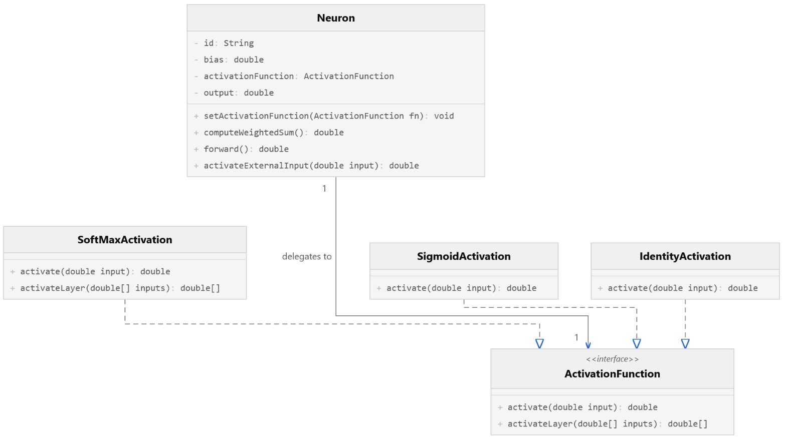
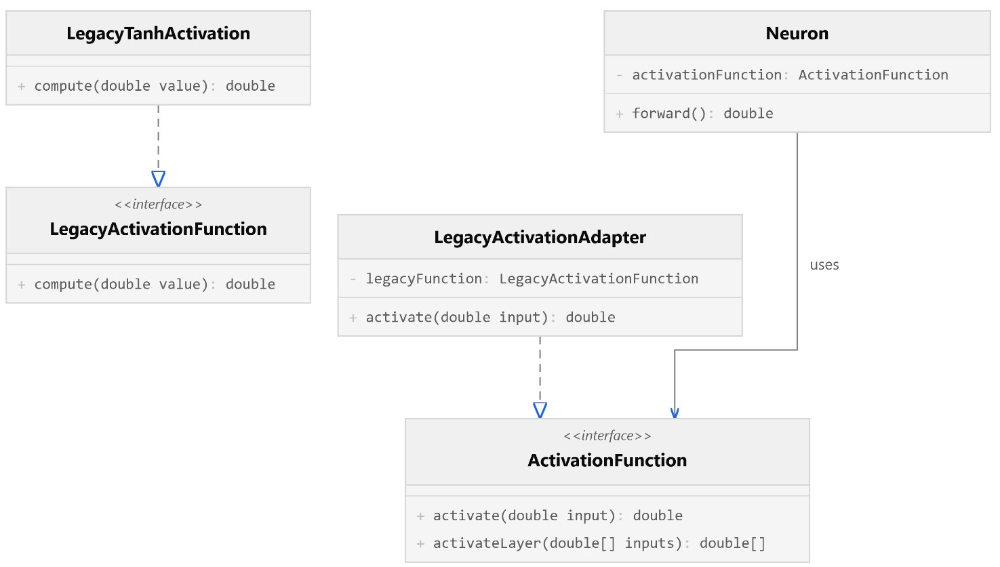
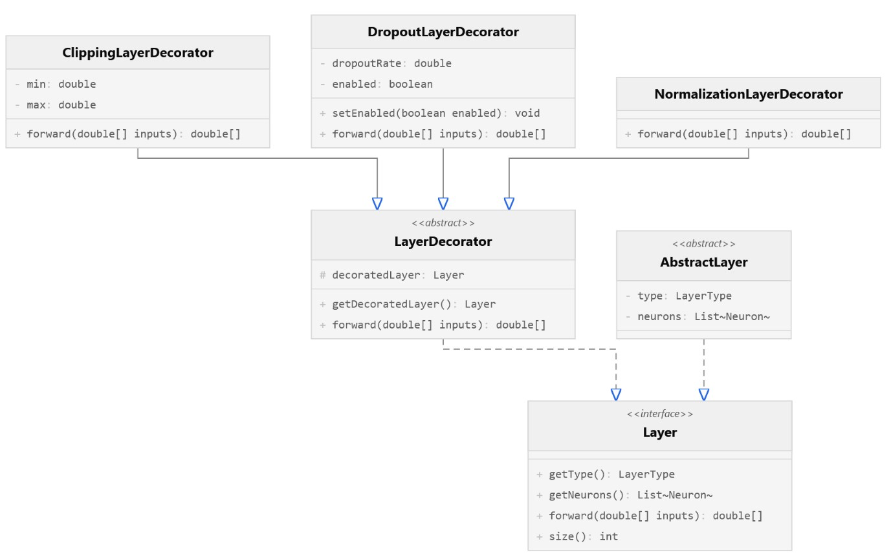
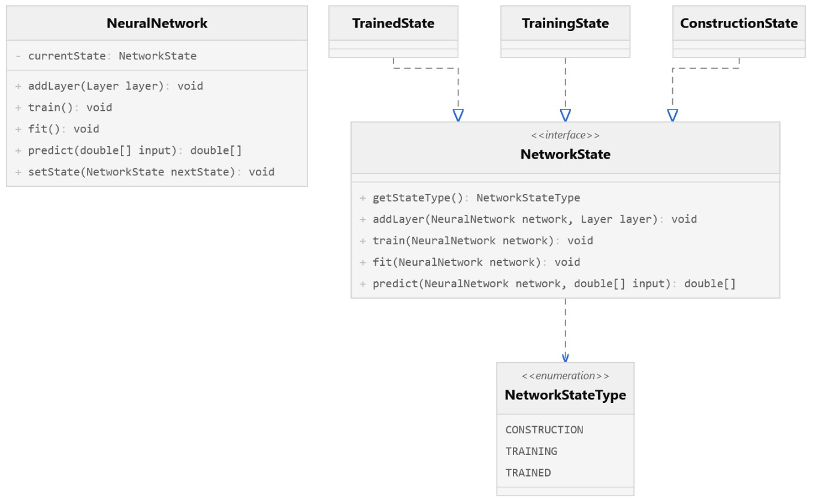
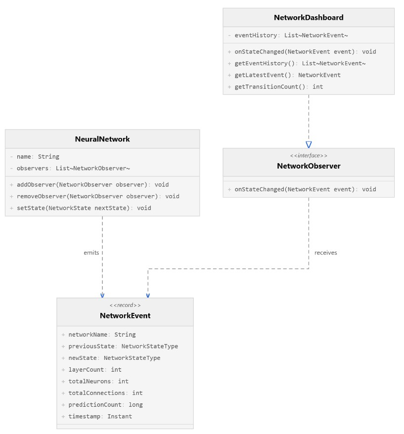
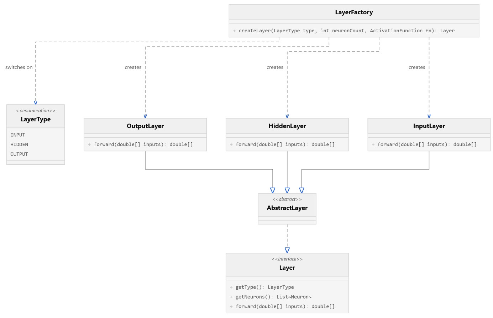
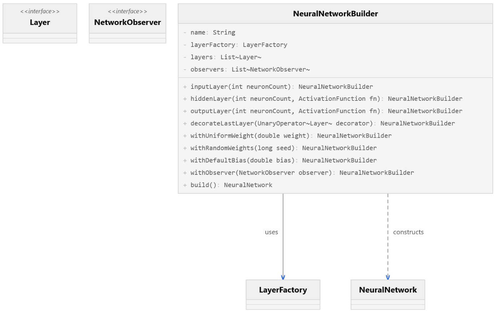

# oop-neural-engine

A pure Java 17 object-oriented artificial neural network engine built to demonstrate **Gang of Four (GoF) Design Patterns** and **Aspect-Oriented Programming (AspectJ)** with compile-time weaving.

---

## Table of Contents

1. [Overview](#overview)
2. [Global Architecture](#global-architecture)
3. [Design Patterns and AOP](#design-patterns-and-aop)
    - [Strategy Pattern](#1-strategy-pattern-activation-functions)
    - [Adapter Pattern](#2-adapter-pattern-legacy-activation-integration)
    - [Decorator Pattern](#3-decorator-pattern-dynamic-layer-behaviors)
    - [State Pattern](#4-state-pattern-network-lifecycle)
    - [Observer Pattern](#5-observer-pattern-monitoring-and-dashboard)
    - [Factory Method Pattern](#6-factory-method-pattern-typed-layer-creation)
    - [Builder Pattern](#7-builder-pattern-fluent-topology-assembly)
    - [Aspect-Oriented Programming (AspectJ)](#8-aspect-oriented-programming-aspectj)
4. [Project Structure](#project-structure)
5. [Prerequisites](#prerequisites)
6. [Build, Test, and Execution](#build-test-and-execution)

---

## Overview

`oop-neural-engine` models an artificial neural network composed of typed layers (`InputLayer`, `HiddenLayer`, `OutputLayer`), neurons with biases and swappable activation functions, and weighted connections (`W` in `[0.0, 1.0]`).

Each neuron computes:

$$S = \sum_{i=1}^{n} X_i W_i + b$$

and forwards $S$ through its configured activation function to downstream layers.

---

## Global Architecture

| Pattern / Paradigm | Category | Purpose | Key Types |
| :--- | :--- | :--- | :--- |
| **Strategy** | Behavioral (GoF) | Encapsulate interchangeable activation functions per neuron | `ActivationFunction`, `SigmoidActivation`, `IdentityActivation`, `SoftMaxActivation` |
| **Adapter** | Structural (GoF) | Integrate legacy activation functions with incompatible interfaces | `LegacyActivationFunction`, `LegacyTanhActivation`, `LegacyActivationAdapter` |
| **Decorator** | Structural (GoF) | Attach dynamic runtime behaviors to any layer | `LayerDecorator`, `NormalizationLayerDecorator`, `DropoutLayerDecorator`, `ClippingLayerDecorator` |
| **State** | Behavioral (GoF) | Enforce lifecycle transitions and execution guards | `NetworkState`, `ConstructionState`, `TrainingState`, `TrainedState` |
| **Observer** | Behavioral (GoF) | Broadcast state transitions and metrics to subscribers | `NetworkObserver`, `NetworkEvent`, `NetworkDashboard` |
| **Factory Method** | Creational (GoF) | Centralize instantiation of input, hidden, and output layers | `LayerFactory`, `LayerType` |
| **Builder** | Creational (GoF) | Fluently assemble and wire fully-connected topologies | `NeuralNetworkBuilder` |
| **AspectJ AOP** | Cross-Cutting | Centralize method execution logging and role-based security | `LoggingAspect`, `SecurityAspect`, `@Secured`, `SecurityContext` |



---

## Design Patterns and AOP

### 1. Strategy Pattern (Activation Functions)

- **Intent:** Define a family of activation algorithms, encapsulate each one, and make them interchangeable at the `Neuron` level—including at runtime via `setActivationFunction(...)`.
- **Implementation:** `SigmoidActivation`, `IdentityActivation`, and `SoftMaxActivation` (with numerically stable vector normalization across output layers) implement `ActivationFunction`.



---

### 2. Adapter Pattern (Legacy Activation Integration)

- **Intent:** Allow an existing activation implementation following an incompatible legacy contract (`LegacyActivationFunction.compute(double)`) to work seamlessly with `Neuron`.
- **Implementation:** `LegacyActivationAdapter` implements `ActivationFunction` and delegates calls to a composed `LegacyActivationFunction` (such as `LegacyTanhActivation`).



---

### 3. Decorator Pattern (Dynamic Layer Behaviors)

- **Intent:** Dynamically attach additional responsibilities to any `Layer` without modifying concrete layer classes or creating rigid inheritance hierarchies.
- **Implementation:** `LayerDecorator` wraps any `Layer` and can be stacked arbitrarily using `NormalizationLayerDecorator` (Z-score normalization), `DropoutLayerDecorator` (toggleable inverted dropout), and `ClippingLayerDecorator` (activation clamping).



---

### 4. State Pattern (Network Lifecycle)

- **Intent:** Control valid operations across the three lifecycle phases of `NeuralNetwork`: `CONSTRUCTION`, `TRAINING`, and `TRAINED`.
- **Transitions:**
    - `CONSTRUCTION` -> `train()` -> `TRAINING` -> `TRAINED`
    - `CONSTRUCTION` -> `fit()` -> `TRAINED`
    - `predict(double[])` is permitted exclusively in the `TRAINED` state.



---

### 5. Observer Pattern (Monitoring and Dashboard)

- **Intent:** Automatically notify dependent monitoring components whenever `NeuralNetwork` transitions between lifecycle states.
- **Implementation:** `NeuralNetwork` emits immutable `NetworkEvent` snapshots to all registered `NetworkObserver` instances, such as `NetworkDashboard`, which logs and records topology and prediction metrics.



---

### 6. Factory Method Pattern (Typed Layer Creation)

- **Intent:** Decouple clients from concrete layer instantiation logic while enforcing valid neuron counts and role typing.
- **Implementation:** `LayerFactory.createLayer(LayerType, int, ActivationFunction)` instantiates `InputLayer`, `HiddenLayer`, or `OutputLayer` populated with configured neurons.



---

### 7. Builder Pattern (Fluent Topology Assembly)

- **Intent:** Simplify multi-step construction of fully-connected neural networks, including layer ordering, dynamic decorators, weight initialization, biases, and observer registration.
- **Implementation:** `NeuralNetworkBuilder` validates the layer sequence (`INPUT` -> `HIDDEN...` -> `OUTPUT`), wires all connections between adjacent layers, and returns a configured `NeuralNetwork`.



---

### 8. Aspect-Oriented Programming (AspectJ)

- **Intent:** Separate cross-cutting logging and security concerns from domain logic using compile-time AspectJ weaving (`ajc`).
- **Implementation:**
    - `LoggingAspect`: `@Around` advice tracing method entry, formatted arguments, execution duration (ms), and thrown exceptions across the application.
    - `SecurityAspect`: `@Before` advice intercepting `@Secured` methods (`train()` and `fit()` restricted to `ADMIN` and `TRAINER`; `predict()` accessible to `ADMIN`, `TRAINER`, and `USER`) against a `ThreadLocal`-backed `SecurityContext`.

---

## Project Structure

```text
oop-neural-engine/
├── pom.xml
├── README.md
├── docs/
│   └── diagrams/
│       ├── global-architecture.puml
│       ├── global-architecture.jpg
│       ├── strategy-pattern.puml
│       ├── strategy-pattern.jpg
│       ├── adapter-pattern.puml
│       ├── adapter-pattern.jpg
│       ├── decorator-pattern.puml
│       ├── decorator-pattern.jpg
│       ├── state-pattern.puml
│       ├── state-pattern.jpg
│       ├── observer-pattern.puml
│       ├── observer-pattern.jpg
│       ├── factory-pattern.puml
│       ├── factory-pattern.jpg
│       ├── builder-pattern.puml
│       └── builder-pattern.jpg
└── src/
    ├── main/java/io/github/hichambenhsine/oopneuralengine/
    │   ├── Main.java
    │   ├── activation/
    │   ├── aspect/
    │   ├── builder/
    │   ├── layer/
    │   │   └── decorator/
    │   ├── model/
    │   ├── observer/
    │   └── state/
    └── test/java/io/github/hichambenhsine/oopneuralengine/
        ├── activation/
        ├── aspect/
        ├── builder/
        ├── layer/
        │   └── decorator/
        └── model/
```

---

## Prerequisites

- **Java:** JDK 17+
- **Build Tool:** Apache Maven 3.8+
- **Core Dependencies:** AspectJ (`aspectjrt`, `aspectjtools` 1.9.22), SLF4J (`2.0.16`), JUnit 5 (`5.10.3`)

---

## Build, Test, and Execution

Compile with AspectJ compile-time weaving and run the full JUnit 5 test suite (28 tests):

```bash
mvn clean test
```

Run the end-to-end demonstration (including the 3-5-2 fully-connected topology):

```bash
mvn clean compile exec:java -Dexec.mainClass="io.github.hichambenhsine.oopneuralengine.Main"
```

---

## License

This project is licensed under the [MIT License](LICENSE).